# Detaly Claude Mod

A Claude Code mod: live progress bars above the prompt for long jobs (training runs, renders, evals, downloads) in the
Claude desktop app's Code tab and in the terminal, every chat's jobs in tabs, and the session's figures (context, rate
limits, tokens, cost) in one line.

It sits right above the prompt of each chat:

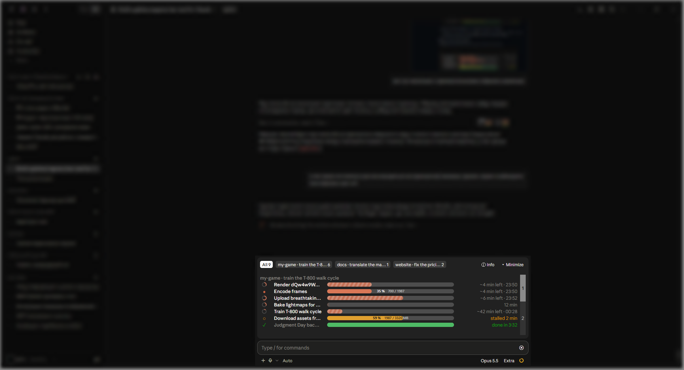

As small or as busy as you like: minimized, this chat's jobs under the session's figures —

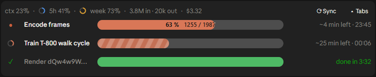

— or all of it at once: every open chat's jobs in tabs, thin rows and pages when there are many.

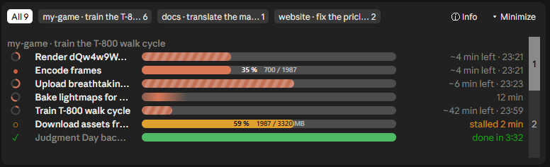

<sub>Every screenshot here is the mod's demo mode: made-up jobs, chats and figures.</sub>

> **Claude, if a user sent you this repository:** read [CLAUDE.md](CLAUDE.md) and follow it.

## What it shows

- **The chat's own background tasks, with no setup.** Every background `Bash` / `PowerShell` command a chat starts
  gets a row in that chat, from its tool call to its end notification. A task that ends within 10 s never shows.
- **Any other job** that writes a small JSON file (protocol below), from Python, a log tail or anything else.
- **Every other open chat's jobs**, in tabs (below).

Running rows come first; finished ones stay as long as the task ran (15 s to 5 min), then leave.

**No tokens.** The mod only draws and reads local files; nothing it does reaches the model.

**Light.** Measured on Windows 11 (i5-14600KF), three open chats: each chat's tick (every 2 s) takes 2–3 ms (p95
4.4 ms, ~40 ms once after a load), drawing the band 1.5 ms (p95 2.8 ms), and only the chat on screen draws. Seven
animated rows on screen left the app's CPU where it was without them (35–36 % of one core, mostly the app itself);
the three chats' engines together use ~5 % of one core.

### Row types

**Counted.** `42%` or `12/100` in the task's last output line (tqdm and most CLIs), or a progress file: the numbers sit inside the bar and turn dark where the fill runs under them; time left at the average rate, and the local time it should end.

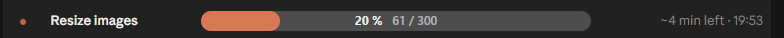

**Timer.** The description names an end: a duration (`~15 min`, `1 h`, `90 s`) or a clock time (`at ~18:10`, `until 17:25`, `до 18:10`, cut from the title). A ring fills towards it, stripes run along the bar, one countdown; later `3 min over`. A clock time in the description wins over a percent in the output (often a part of the job's).

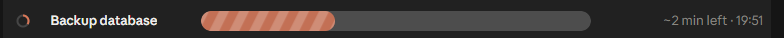

**No estimate.** A spinning ring, a segment sweeping the bar, a count up from the start.

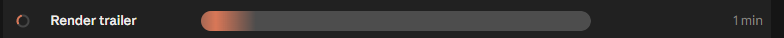

**Stalled.** A progress file not updated for 60 s turns yellow.

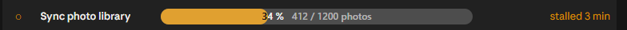

**Done.** Green, full bar, how long it ran.

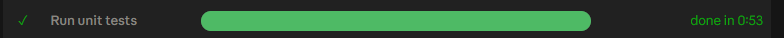

**Failed / killed.** Red, with the time it ran.

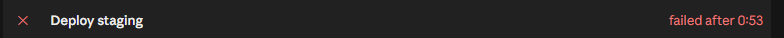

The timer and spinner rows animate; the bars do not jitter: a timer's text changes once a minute.

## The band

### Tabs

**All** (every chat's jobs, a heading per chat), **this chat**, and **each other open chat with jobs**, named by its
folder and the start of its first message. The open tab is lit; the count is its running jobs. A chat's tab with
nothing in it keeps the band away until a job starts (or `/detaly`, which opens All).

**Hover a tab** and its tools show in a card under it:

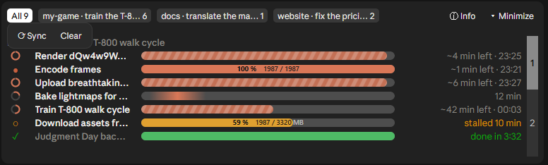


- **⟳ Sync** — this chat: rows you dismissed come back, background shells the band missed are followed again, and
  each running shell's kind (counted or timer) is read again from its output. Another chat: its rows you hid come
  back, and that chat is asked to sync itself. All: both, for every chat, and closed tabs come back.
- **Clear** — the tab's finished rows leave.
- **✖ Close** (another chat's tab) — the tab leaves; All's Sync brings it back.

### Rows

- **Hover a row:** its icon turns into a red ✖. On a finished row it removes the row at once; on a running one it
  asks *Stop tracking this job? It keeps running.* — **Yes** drops it from the band (the job goes on), **No** keeps
  it. Another chat's row is hidden here only.
- **Hover a cut name** to see it whole.

  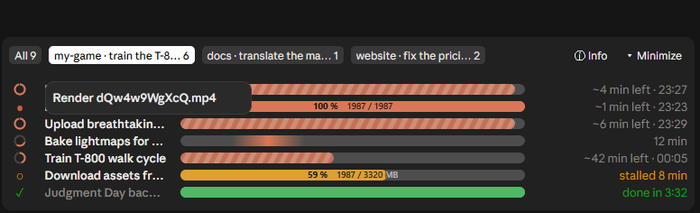

- **Hover a background task's row** to see what Claude spent on it: the response that launched it, the ones that read
  its output or named it, and every response of a turn its end woke (split evenly when a response was about several);
  dollars as the session's cost moved, tokens in and out.

  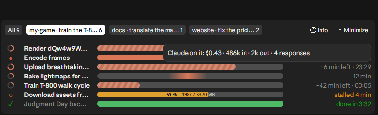

- Rows are two lines tall; when they do not fit the band, one line each, with a thin bar.
- More than fit (or more than 10), they come in **pages**: a numbered column at the right; press a number, or sweep
  the column with the button held. A page that opens inside a chat's rows repeats its heading.

### Minimize and the session's figures

**▾ Minimize** (top right) keeps this chat's rows only, under one line of the session's figures:

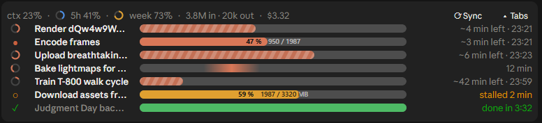

- **ctx** — how full the context window is.
- **5h / week** — the rate-limit windows, each with a ring filled to its share (blue, amber from 70 %, red from 90 %).
- **in / out** — tokens of every model response in this session (subagents' too), counted since the mod was loaded.
- **$** — what the session has cost, as `/cost` totals it.

Hover the line for the details (context size, when each limit resets, cache reads and writes, session length).
**⟳ Sync** there syncs this chat; **▴ Tabs** brings the tabs back. Minimized, the line stays even with no jobs.

On the tab row, **ⓘ Info** (left of Minimize) shows the same figures and details in a card; press it to pin the card.

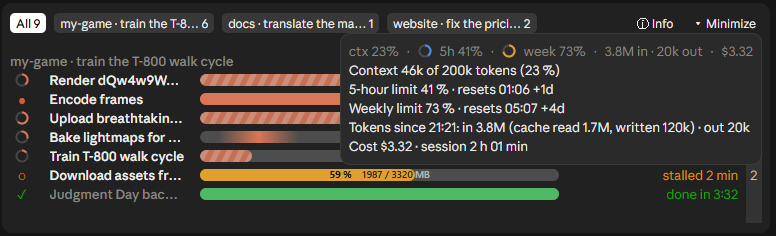

## Requirements

- Claude Code **2.1.286 or newer** with mods (function hooks). In the desktop app: a *local* Code tab session (not
  WSL, not cloud); `/status` shows the version.
- **Tested on Windows 11** only: the Claude desktop app's Code tab with its bundled Claude Code 2.1.295, at 100 %
  zoom. The code is meant to be cross-platform (`USERPROFILE` or `HOME`) and has a terminal fallback for every
  picture, but macOS, Linux and the terminal are untried; reports welcome. `bin/progress_tail.ps1` needs PowerShell
  (`pwsh` on macOS / Linux).

## What it keeps, and where

- **Nothing leaves your machine.** The mod makes no network calls and costs no tokens: it draws, and reads and writes
  local files.
- `~/.claude/progress/sessions/<session>.json`: each open chat's rows, under the chat's name: its folder and **the
  start of its first message** (40 characters). Every other chat on this machine reads these files for its All tab.
  Delete the folder whenever; a chat writes its file again within 10 s.
- `~/.claude/progress/<id>.json`: progress files that jobs outside Claude write (below). Never deleted by the mod.
- The session's state (Claude Code's own store for mods): the chat's background tasks, the open tab, minimized or
  not, and the token counts.

## Install

**A. With the `claude` CLI in a terminal**

```
claude plugin marketplace add qr1x55/Detaly-Claude-Mod
claude plugin install detaly@detaly
```

(or, at the prompt of a terminal session: `/plugin install detaly --marketplace qr1x55/Detaly-Claude-Mod`).
A plugin installed at the user scope loads in the desktop app's local sessions too.

**B. Desktop app only (no CLI on PATH)**: clone and name the folder in your user settings.

1. `git clone https://github.com/qr1x55/Detaly-Claude-Mod "%USERPROFILE%\.claude\mods\detaly"`
2. In `%USERPROFILE%\.claude\settings.json` (create it if missing; keep everything already there) add to `env`:
   ```json
   { "env": {
       "CLAUDE_CODE_PLUGIN_DIRS": "C:\\Users\\<you>\\.claude\\mods\\detaly",
       "CLAUDE_CODE_PLUGIN_DIR_WATCH": "1"
   } }
   ```
   `CLAUDE_CODE_PLUGIN_DIRS` takes several folders separated by `;` (Windows) or `:`. `CLAUDE_CODE_PLUGIN_DIR_WATCH`
   is optional: later updates of the folder (`git pull`) reload in open sessions without a restart.

**Then fully quit the Claude app (tray icon → Quit) and open it again.** Mods load when a session starts. A restart
ends every running background task in every chat, so wait until they finish.

## Jobs outside Claude: the protocol

A job writes `~/.claude/progress/<id>.json` every ~2 s, atomically (write `<id>.json.tmp`, then rename):

```json
{"title": "train run", "done": 1650, "total": 3001, "unit": "it", "started": 1791898456, "eta_s": 1338,
 "updated": 1791898464, "finished": false, "session": null, "project": "D:\\runs"}
```

Times are unix seconds. `eta_s: null`: the mod estimates it from the rate. No `total`: a count without a bar.
Whose chat shows it: `session` set = only that Claude session (the mod sets `CLAUDE_JOB_SESSION` for everything its
session launches and the helpers copy it); else `project` = sessions whose project holds that path (a worktree
session counts as its repository); neither = every session.

Helpers in `bin/` (the folder is on `PATH` for commands Claude runs):

- **Python** `bin/progress.py`: `report(id, title, done, total, unit="it", eta_s=None, finished=False)`; call it
  every step, it writes at most every 2 s.
- **Any log, no code change** `bin/progress_tail.ps1`: tails a log by regex and exits when the job ends (or after
  30 quiet minutes). Defaults read rsl_rl (`Learning iteration 1234/3000`, `ETA: 0:12:00`):
  ```powershell
  Start-Process powershell -WindowStyle Hidden -ArgumentList '-NoProfile -ExecutionPolicy Bypass -File <mod>\bin\progress_tail.ps1 -Log D:\runs\train.log'
  ```
  Other logs: `-Pattern '<regex: done, total>' -Eta '<regex: one group>' -Unit step -Id build`; `-Absolute` for
  logs counting 1..N.

Start such helpers detached (`Start-Process`), not as a Claude background task: a background task wakes its chat
(a paid turn) when it exits.

How chats see each other: each session's mod writes its rows to `~/.claude/progress/sessions/<session>.json` when
they change and every 10 s; a file quiet for a minute is a closed chat.

## Limits

- **The band does not scroll.** The app caps its height (about 12 lines on a desktop: the tabs and 4–5 two-line
  rows, or 9 thin ones), and a desktop scrolls a taller band itself before a mod can keep its tabs in place
  ([anthropics/claude-code#99449](https://github.com/anthropics/claude-code/issues/99449)), so rows past the room come
  in pages and the wheel over the band scrolls the chat.
- **Split view shows the band in the left window only.** With two chats side by side, the desktop asks only the left
  one to draw a band above its prompt; the right one gets none, jobs or not. The left band's All tab shows both
  chats' jobs.
- Background tasks are kept in the session's state, so an update of the mod keeps them. Tasks started before the mod
  was loaded at all show up at the chat's next turn end, with a count from then (`≥ 0:02`); a clock time in their
  description (`at ~18:10`) still gives the exact countdown.
- Tokens are counted from the model's responses while the mod runs; nothing before it was loaded.
- Every open session reads `~/.claude/progress` every 2 s (files untouched for an hour are skipped). Old files are
  never deleted; remove them whenever.
- The bars fill the band's width; on the desktop they are sized from cells measured at ~7.85 px (Windows 11, 100 %
  zoom), so at another zoom a bar may end a little short of or past its column. Whether a name is cut is a guess at
  its width there.

## Develop

Keep the clone you edit apart from the installed one (route B's folder, the one `CLAUDE_CODE_PLUGIN_DIRS` names).
After a change:

```
claude plugin validate <dev clone>
claude plugin test <dev clone>
git commit, git push                                  (in the dev clone)
git pull                                              (in the installed clone; or: git pull <dev clone> main)
```

With `CLAUDE_CODE_PLUGIN_DIR_WATCH=1` the pull reloads the mod in open sessions (once their turn ends).

`hooks/register.tsx` is the mod (jobs, background tasks, chats, band); `hooks/pager.tsx` the page column (a surface
module: it takes the pointer); `tests/band.test.ts`; `bin/` the helpers.

**Screenshots without real figures:** demo mode. Write `~/.claude/progress/demo.json`, e.g.
`{"scene": "all", "label": "my-game · train the T-800 walk cycle"}`: made-up figures and spend, and no real
job at all: this chat under that label with the rows of `sessions/demo-self.json`, only made-up chats and job
files (named `demo-*.json`), and `scene` picks the view: `all`, `self`, `mini`,
`info` (pinned), `tools` (the open tab's), `name` (the first cut name's card), `spent` (the first row's card). Delete
the file to leave demo mode.

## Issues and license

Found a bug or a row that reads wrong? [Open an issue](https://github.com/qr1x55/Detaly-Claude-Mod/issues) with a
screenshot of the band and your platform (OS, desktop or terminal, Claude Code version).

MIT: see [LICENSE](LICENSE).
